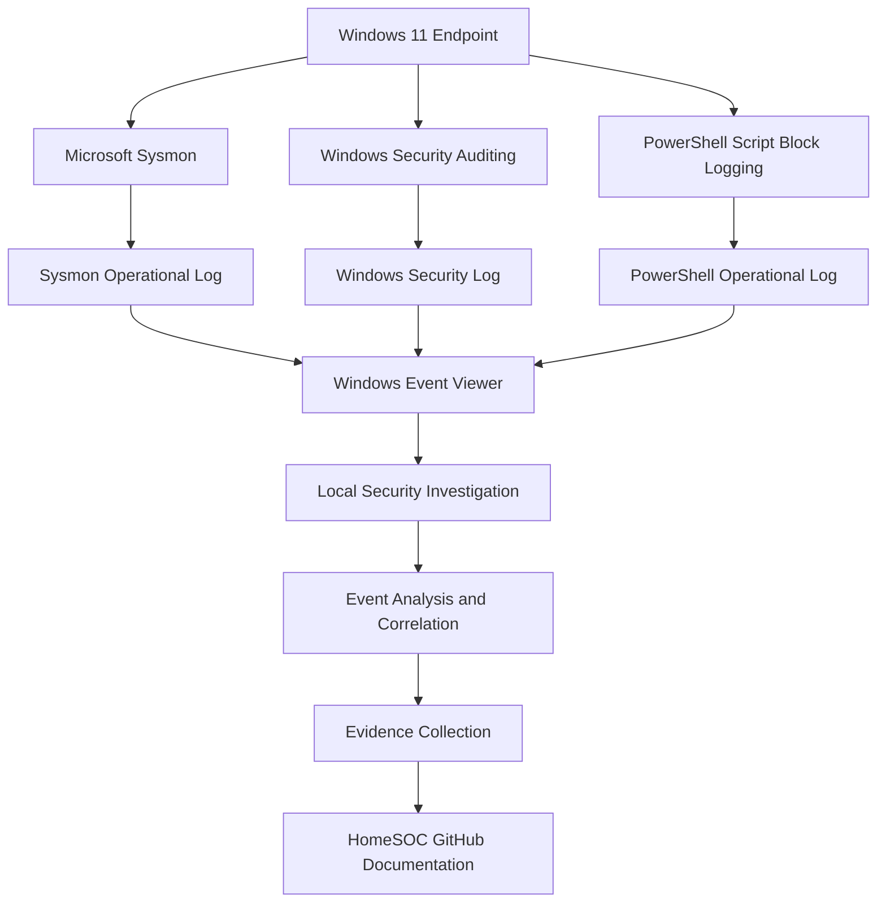
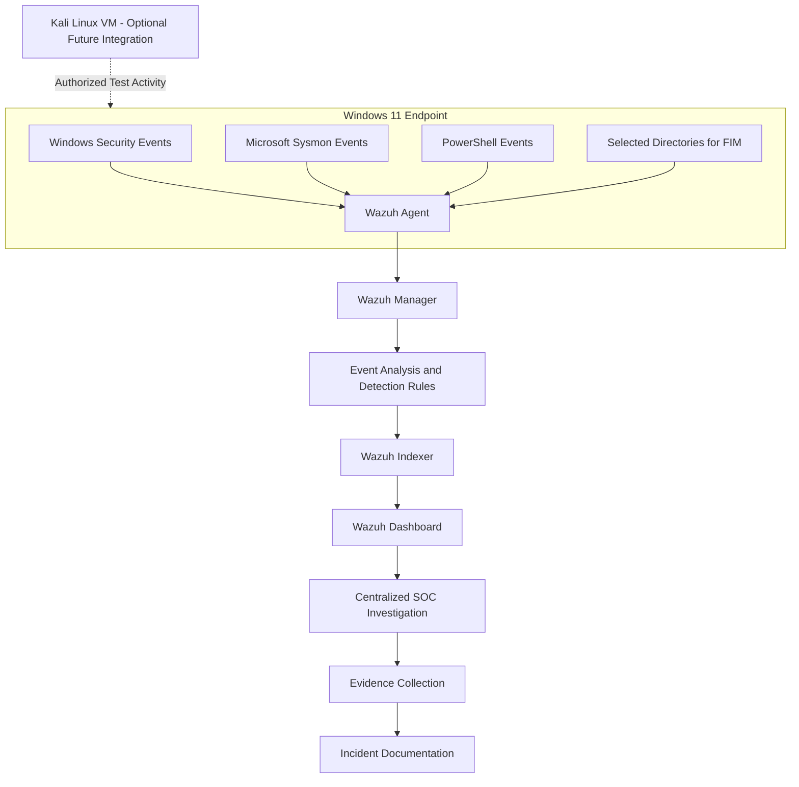

# HomeSOC Lab Architecture

## Overview

HomeSOC is a personal cybersecurity lab designed to develop practical Security Operations Center (SOC) skills through endpoint monitoring, security event analysis, and controlled investigation exercises.

The project is being developed in stages.

The first stage focuses on Windows 11 security monitoring using Microsoft Sysmon, Windows Security Auditing, PowerShell Script Block Logging, and Windows Event Viewer.

Four local detection labs have been implemented and tested successfully.

The next stage involves integrating Wazuh to provide centralized security monitoring, event collection, threat detection, and alert investigation.

This document distinguishes between the architecture already implemented and the proposed Wazuh environment.

---

## 1. Current Architecture — Local Windows Monitoring

**Status: Implemented and Verified Through Controlled Testing**

The current environment uses a Windows 11 endpoint to generate and investigate security events locally.



### Current Components

| Component | Purpose | Status |
|---|---|---|
| Windows 11 | Monitored endpoint | Implemented |
| Microsoft Sysmon | Process creation telemetry | Verified |
| Windows Security Auditing | Authentication and file activity monitoring | Verified |
| PowerShell Script Block Logging | Script execution monitoring | Verified |
| Windows Event Viewer | Local event investigation | Used |
| PowerShell | Configuration and controlled test execution | Used |
| GitHub | Evidence and investigation documentation | Implemented |

The current implementation does not require a dedicated SIEM server.

Security events were generated through controlled tests and investigated locally.

Some auditing configurations were enabled temporarily for testing and subsequently restored. In particular, File System Auditing was returned to its original `No Auditing` setting after Detection Lab 01.

Therefore, the successful test results demonstrate local logging capabilities rather than continuous monitoring of every event source.

---

## 2. Current Monitoring Data Flow

The local investigation workflow is:

```text
Windows 11 Endpoint
        |
        v
Security Monitoring Sources
        |
        +--- Microsoft Sysmon
        |
        +--- Windows Security Auditing
        |
        +--- PowerShell Script Block Logging
        |
        v
Windows Event Logs
        |
        v
Windows Event Viewer
        |
        v
Security Event Investigation
        |
        v
Evidence Collection
        |
        v
HomeSOC GitHub Documentation
```

This workflow demonstrates how Windows security telemetry can be investigated without centralized SIEM infrastructure.

---

## 3. Detection Labs and Monitored Events

Four controlled security monitoring exercises were completed.

| Detection Lab | Event IDs | Monitoring Purpose |
|---|---|---|
| File Integrity Monitoring | 4663, 4660 | File creation, modification, and deletion investigation |
| Failed Authentication Detection | 4625 | Failed Windows authentication attempts |
| PowerShell Monitoring | 4104 | PowerShell Script Block Logging |
| Sysmon Process Analysis | 1 | Process creation and parent-child process relationships |

### Lab 01 — File Integrity Monitoring

Windows File System Auditing was configured for a dedicated test directory.

Controlled file creation, modification, and deletion operations were performed.

Security Events 4663 and 4660 were analyzed to identify file operations and correlate object deletion activity.

### Lab 02 — Failed Authentication Detection

A controlled failed authentication attempt was generated using a dedicated Windows test account.

Windows Security Event ID 4625 was examined to investigate authentication failure details.

### Lab 03 — PowerShell Monitoring

PowerShell Script Block Logging was configured and tested using harmless PowerShell activity.

Event ID 4104 was investigated to examine recorded script block content.

### Lab 04 — Sysmon Process Analysis

Microsoft Sysmon was used to investigate process creation activity.

Sysmon Event ID 1 provided information about executable paths, command lines, process identifiers, parent-child relationships, integrity levels, and file hashes.

All four investigations were performed locally using Windows Event Viewer.

---

## 4. Planned Architecture — Wazuh SIEM Integration

**Status: Planned — Not Yet Deployed**

The next stage of HomeSOC will introduce Wazuh as a centralized security monitoring platform.

The planned Wazuh environment will consist of:

- Windows 11 monitored endpoint
- Microsoft Sysmon
- Windows Security and PowerShell event logs
- Wazuh Agent
- Wazuh Manager
- Wazuh Indexer
- Wazuh Dashboard
- SOC investigation and incident documentation workflow

### Planned Architecture Diagram



This diagram presents the intended logical monitoring workflow.

The exact deployment environment and network configuration will be finalized when Wazuh is implemented.

### Planned Wazuh Components

| Component | Purpose | Status |
|---|---|---|
| Windows 11 | Monitored endpoint | Available |
| Microsoft Sysmon | Detailed endpoint telemetry | Locally verified |
| Wazuh Agent | Windows log collection and file integrity monitoring | Pending |
| Wazuh Manager | Event processing, rule evaluation, and alert generation | Pending |
| Wazuh Indexer | Security event indexing and storage | Pending |
| Wazuh Dashboard | Centralized event visualization and investigation | Pending |
| Kali Linux VM | Optional controlled testing environment | Not integrated into HomeSOC |

The Wazuh Agent will collect selected Windows event channels and provide endpoint monitoring capabilities.

Wazuh File Integrity Monitoring will be configured separately from the local Windows File System Auditing used in Detection Lab 01.

---

## 5. Planned Wazuh Data Flow

The intended centralized monitoring workflow is:

```text
Windows 11 Endpoint
        |
        v
Windows Event Logs / Sysmon
        |
        v
Wazuh Agent
        |
        v
Wazuh Manager
        |
        v
Security Analysis and Alerts
        |
        v
Wazuh Indexer
        |
        v
Wazuh Dashboard
        |
        v
SOC Investigation
        |
        v
Incident Documentation
```

The Wazuh Agent will also support file integrity monitoring for selected directories.

Unlike the existing local investigation workflow, the planned architecture will support centralized visibility and analysis of security telemetry.

---

## 6. Security and Testing Considerations

The project follows a controlled testing approach.

Security activities are performed only on systems owned or explicitly authorized by the project author.

Testing is intended to generate understandable security telemetry without disrupting unrelated systems.

Collected screenshots are reviewed before publication, and personal Windows account information is redacted where appropriate.

Sensitive configuration values, passwords, authentication tokens, and other secrets must not be committed to the public GitHub repository.

Future testing involving Kali Linux will be performed within an appropriately isolated and authorized lab environment.

---

## 7. Architecture Implementation Status

| Architecture Component | Current Status |
|---|---|
| Windows endpoint | Implemented |
| Local Windows security monitoring | Verified |
| Sysmon process monitoring | Verified |
| PowerShell logging investigation | Verified |
| Authentication monitoring investigation | Verified |
| File activity monitoring investigation | Verified |
| Local event correlation | Demonstrated |
| Evidence collection | Completed for four labs |
| Wazuh Agent integration | Pending |
| Wazuh Manager deployment | Pending |
| Wazuh Indexer and Dashboard | Pending |
| Centralized security alert investigation | Pending |
| First formal investigation report (INV-001) | Completed |
| Additional investigation reports | Planned |
| Isolated Kali testing integration | Planned |

---

## 8. Future Architecture Improvements

The next development milestones are:

1. Select a suitable Wazuh deployment environment.
2. Deploy and verify the Wazuh components.
3. Install and enroll the Windows Wazuh Agent.
4. Configure collection of relevant Windows Event Logs.
5. Integrate Microsoft Sysmon telemetry.
6. Configure Wazuh File Integrity Monitoring.
7. Generate controlled test activities and investigate the resulting centralized alerts.
8. Develop additional formal SOC investigation reports.
9. Extend the lab with additional controlled security testing scenarios.

---

## Conclusion

The first phase of HomeSOC successfully demonstrated local Windows endpoint security monitoring and event investigation.

Four detection labs were implemented and documented using Windows Security Events, Microsoft Sysmon, PowerShell logging, and Event Viewer.

The planned Wazuh architecture will extend these capabilities by introducing centralized log collection, detection, and security alert investigation.

Wazuh integration has not yet been deployed or verified.
