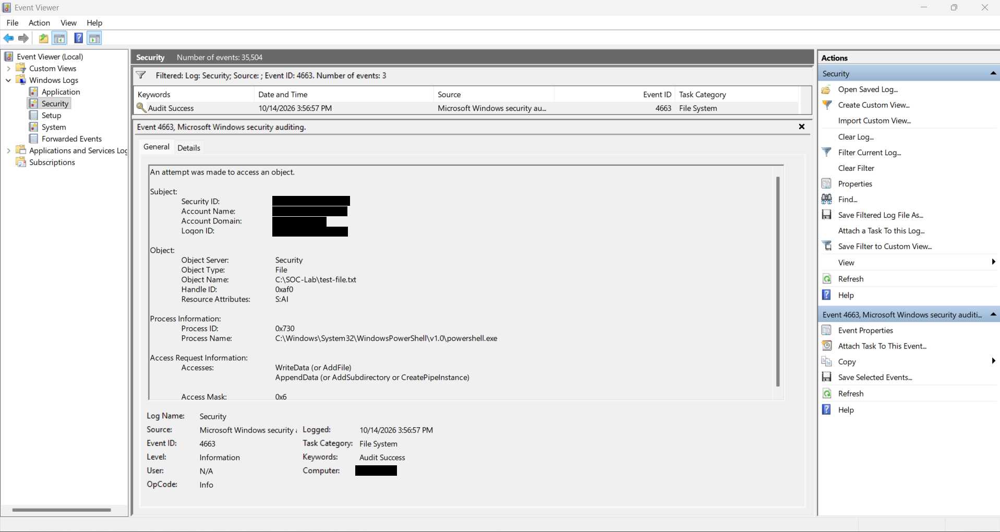
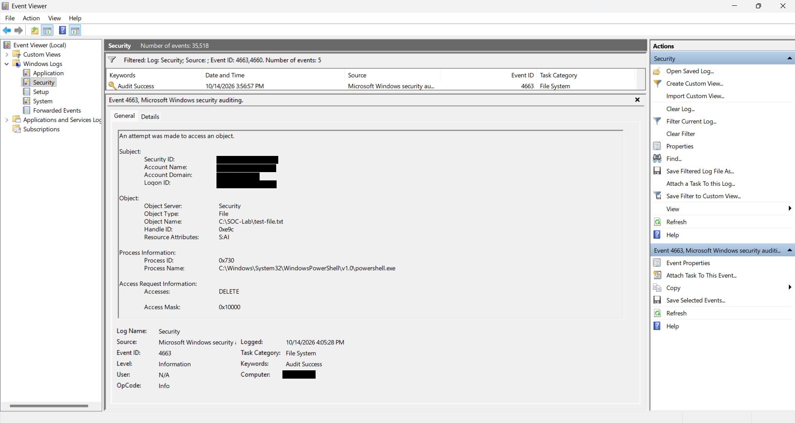
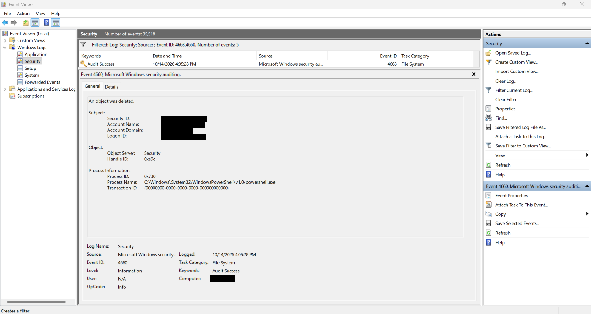

# Detection Lab 01 — File Integrity Monitoring

## Status

🟠 In Progress — Local Windows file activity monitoring verified.

Wazuh SIEM and File Integrity Monitoring integration remain pending.

---

## Objective

The objective of this lab is to monitor file creation, modification, and deletion activities on a Windows 11 endpoint using Windows File System Auditing.

The lab demonstrates how SOC analysts can investigate file system changes by examining Windows Security Events, identifying the processes responsible for file operations, and correlating related security events.

The local investigation provides a foundation for future integration with Wazuh File Integrity Monitoring (FIM).

---

## Environment

| Component | Configuration |
|---|---|
| Endpoint | Windows 11 |
| Monitoring Method | Windows File System Auditing |
| Log Source | Windows Security Event Log |
| Event IDs | 4663 and 4660 |
| Test Directory | `C:\SOC-Lab` |
| Test File | `test-file.txt` |
| Testing Tool | Windows PowerShell |
| SIEM | Wazuh — Pending |
| Endpoint Agent | Wazuh Agent — Pending |

---

## Lab Scenario

A dedicated directory was created on the Windows 11 endpoint to conduct controlled file activity monitoring.

Windows File System Auditing was enabled, and auditing permissions were configured for the test directory.

Three controlled activities were performed:

1. Create a text file and write content.
2. Modify the existing file by appending content.
3. Delete the file.

The resulting Windows Security Events were examined using Event Viewer.

The purpose was to determine whether Windows could record the activities and provide sufficient information for a basic security investigation.

---

## Implementation

### Step 1 — Create the Test Directory

Administrator PowerShell was used to create a dedicated monitoring directory.

```powershell
New-Item -Path "C:\SOC-Lab" -ItemType Directory
```

The directory was verified using:

```powershell
Test-Path "C:\SOC-Lab"
```

The command returned `True`, confirming that the directory existed.

### Step 2 — Enable Windows File System Auditing

The existing File System Auditing policy was checked using:

```powershell
auditpol /get /subcategory:"File System"
```

The initial configuration showed:

```text
File System    No Auditing
```

Successful file system auditing was enabled using:

```powershell
auditpol /set /subcategory:"File System" /success:enable
```

The configuration was verified:

```powershell
auditpol /get /subcategory:"File System"
```

The resulting configuration showed:

```text
File System    Success
```

This enabled successful file system auditing at the Windows audit policy level.

### Step 3 — Configure Directory Auditing

Directory-specific auditing was configured through:

`C:\SOC-Lab → Properties → Security → Advanced → Auditing`

The following settings were applied:

| Setting | Configuration |
|---|---|
| Principal | Everyone |
| Type | Success |
| Applies to | This folder, subfolders and files |

The following advanced auditing permissions were selected:

- Create files / write data
- Create folders / append data
- Write attributes
- Write extended attributes
- Delete
- Delete subfolders and files

These settings were applied to the test directory to record relevant file operations.

The configured auditing entry was verified using:

```powershell
(Get-Acl "C:\SOC-Lab" -Audit).Audit | Format-List IdentityReference,FileSystemRights,AuditFlags,InheritanceFlags
```

The output confirmed successful auditing for `Everyone`, with write and delete permissions inherited by files and subfolders.

---

## Controlled Test Activities

### Test 01 — File Creation and Writing

A text file was created using Administrator PowerShell.

```powershell
New-Item -Path "C:\SOC-Lab\test-file.txt" -ItemType File
```

Content was written to the file:

```powershell
Set-Content -Path "C:\SOC-Lab\test-file.txt" -Value "HomeSOC Lab 01 - File Creation Test"
```

The file contents were verified:

```powershell
Get-Content "C:\SOC-Lab\test-file.txt"
```

Windows successfully recorded a corresponding file write operation in the Security Event Log.

### Test 02 — File Modification

Additional text was appended to the existing file.

```powershell
Add-Content -Path "C:\SOC-Lab\test-file.txt" -Value "HomeSOC Lab 01 - File Modification Test"
```

This operation preserved the existing file contents and added another line.

A new Windows Security Event ID 4663 was generated, recording write and append access to the file.

### Test 03 — File Deletion

The test file was deleted using PowerShell.

```powershell
Remove-Item -Path "C:\SOC-Lab\test-file.txt"
```

The deletion activity generated security events associated with DELETE access and object deletion.

Windows Security Event IDs 4663 and 4660 were examined to investigate the activity.

---

## Evidence

### Evidence 01 — File Creation and Writing

The following screenshot shows Windows Security Event ID 4663 generated during the controlled file creation and writing test.


The event recorded a write operation performed by PowerShell on the monitored file.

### Evidence 02 — File Modification

The following screenshot shows Event ID 4663 generated after additional content was appended to the existing file.



The event recorded WriteData and AppendData access associated with the controlled modification test.

### Evidence 03 — File DELETE Access

The following screenshot shows Event ID 4663 recording DELETE access to the monitored file.



The event identifies the affected file, process, access mask, and handle identifier.

### Evidence 04 — Object Deletion

The following screenshot shows Windows Security Event ID 4660, indicating that an object was deleted.



Event ID 4660 was correlated with Event ID 4663 to identify the deleted file.

Personal Windows account information was redacted from the published screenshots.

---

## Observed Results

### Investigation 01 — File Creation and Writing

| Field | Observed Value |
|---|---|
| Event ID | 4663 |
| Event Type | File System Access |
| Object Name | `C:\SOC-Lab\test-file.txt` |
| Process | `powershell.exe` |
| Accesses | WriteData (or AddFile) |
| Access Mask | `0x2` |
| Timestamp | 2026-10-14 15:52:30 (Sri Lanka) |
| Audit Result | Success |

The event confirmed that PowerShell performed an audited write operation on the test file.

The event was consistent with the controlled creation and writing procedure.

### Investigation 02 — File Modification

| Field | Observed Value |
|---|---|
| Event ID | 4663 |
| Event Type | File System Access |
| Object Name | `C:\SOC-Lab\test-file.txt` |
| Process | `powershell.exe` |
| Accesses | WriteData, AppendData |
| Access Mask | `0x6` |
| Timestamp | 2026-10-14 15:56:57 (Sri Lanka) |
| Audit Result | Success |

The event demonstrated that Windows recorded the write and append access associated with modifying the existing file.

The recorded access mask included:

- `0x2` — WriteData
- `0x4` — AppendData

### Investigation 03 — File Deletion

Two related Windows Security Events were identified during the deletion test.

**Event ID 4663 — DELETE Access**

| Field | Observed Value |
|---|---|
| Event ID | 4663 |
| Object Name | `C:\SOC-Lab\test-file.txt` |
| Process | `powershell.exe` |
| Process ID | `0x730` |
| Handle ID | `0xe9c` |
| Accesses | DELETE |
| Access Mask | `0x10000` |
| Timestamp | 2026-10-14 16:05:28 (Sri Lanka) |

**Event ID 4660 — Object Deleted**

| Field | Observed Value |
|---|---|
| Event ID | 4660 |
| Description | An object was deleted |
| Process | `powershell.exe` |
| Process ID | `0x730` |
| Handle ID | `0xe9c` |
| Timestamp | 2026-10-14 16:05:28 (Sri Lanka) |
| Audit Result | Success |

Both events contained matching process and handle identifiers.

This allowed the deletion event to be correlated with the specific monitored file.

---

## Analysis

### File Creation and Modification

Windows Security Event ID 4663 provides information about audited access to files and other objects.

During the controlled tests, PowerShell generated file access events containing the object name, process information, requested access rights, and timestamp.

The creation and modification tests produced different access masks.

The file creation and writing event recorded WriteData access with mask `0x2`.

The modification event recorded WriteData and AppendData access with mask `0x6`.

These observations were consistent with the PowerShell commands executed during the tests.

Event ID 4663 alone does not reliably distinguish successful file creation from modification. The investigation therefore used the controlled test procedure and corresponding timestamps to interpret the activity.

### File Deletion and Event Correlation

The deletion investigation demonstrated how Windows Security Events can be correlated to identify affected objects.

Event ID 4663 recorded DELETE access to:

`C:\SOC-Lab\test-file.txt`

Event ID 4660 confirmed that an object was deleted.

The events shared the following identifiers:

| Correlation Field | Event 4663 | Event 4660 |
|---|---|---|
| Process ID | `0x730` | `0x730` |
| Handle ID | `0xe9c` | `0xe9c` |
| Timestamp | 16:05:28 | 16:05:28 |

The matching identifiers established a connection between the file DELETE access and the recorded object deletion.

This demonstrates how SOC analysts can use multiple Windows Security Events to reconstruct file system activity.

---

## Security Assessment

All file operations were performed intentionally in a dedicated test directory.

The observed events were consistent with the controlled PowerShell activities.

No malicious behavior was identified during these tests.

The investigation demonstrated that Windows File System Auditing can provide useful evidence of file operations, including the responsible process and affected file.

However, the current implementation provides Windows file activity auditing rather than a complete Wazuh File Integrity Monitoring deployment.

No Wazuh alerts, centralized log collection, or file integrity baseline comparisons have been verified.

Wazuh SIEM integration remains pending.

---

## MITRE ATT&CK Mapping

The observed activities were legitimate administrative test operations.

File modification and deletion can occur during malicious activity, but the evidence collected in this lab does not establish malicious intent or a specific adversary technique.

Therefore, no malicious MITRE ATT&CK technique is attributed to these controlled tests.

---

## Lessons Learned

- Configured Windows File System Auditing.
- Created a dedicated directory for controlled security monitoring.
- Applied directory-specific auditing permissions.
- Generated file creation, modification, and deletion events.
- Investigated Windows Security Event ID 4663.
- Investigated Windows Security Event ID 4660.
- Compared write, append, and delete access masks.
- Correlated related security events using process and handle identifiers.
- Collected and documented evidence from Windows Event Viewer.
- Understood the difference between local file access auditing and Wazuh File Integrity Monitoring.

---

## Future Improvements

- Deploy Wazuh SIEM in an environment with sufficient resources.
- Install and configure the Wazuh Agent on the Windows endpoint.
- Configure Wazuh File Integrity Monitoring for selected directories.
- Compare file integrity baselines and detect changes through Wazuh.
- Investigate centralized security alerts using the Wazuh Dashboard.
- Document the resulting alerts and detection workflow.

---

## Conclusion

The local file activity monitoring tests were successfully completed using Windows File System Auditing.

Windows Security Events 4663 and 4660 provided evidence of controlled file creation/writing, modification, and deletion activities.

The investigation also demonstrated how related security events can be correlated to identify the process and object involved in a deletion.

The results establish a foundation for future Wazuh File Integrity Monitoring integration.
