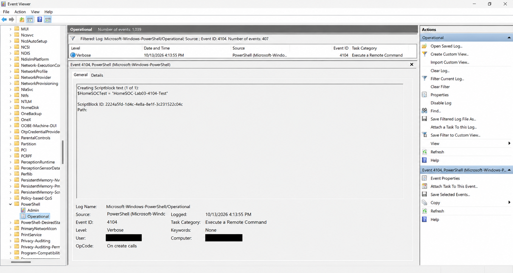

# Detection Lab 03 — PowerShell Monitoring

## Status

🟠 In Progress — Local PowerShell Script Block Logging verified.

Wazuh SIEM integration remains pending.

---

## Objective

The objective of this lab is to configure PowerShell Script Block Logging on a Windows 11 endpoint and investigate the resulting security telemetry using Windows Event Viewer.

The lab demonstrates how SOC analysts can examine PowerShell script execution using Event ID 4104.

---

## Environment

| Component | Configuration |
|---|---|
| Endpoint | Windows 11 |
| Monitoring Feature | PowerShell Script Block Logging |
| Log Source | Microsoft-Windows-PowerShell/Operational |
| Event ID | 4104 |
| Investigation Tool | Windows Event Viewer |
| Logging Configuration | Windows Registry Policy |
| SIEM Integration | Wazuh — Planned |

---

## Lab Scenario

PowerShell Script Block Logging was enabled on the Windows 11 endpoint.

A controlled PowerShell test was performed using harmless commands.

The resulting events were investigated through Windows Event Viewer to determine whether the executed script block was recorded.

---

## Implementation

### Step 1 — Verify Logging Configuration

Administrator PowerShell was used to check the existing Script Block Logging policy.

No configured value was returned from the registry location.

### Step 2 — Enable Script Block Logging

The following commands were executed in Administrator PowerShell:

```powershell
$path = 'HKLM:\SOFTWARE\Policies\Microsoft\Windows\PowerShell\ScriptBlockLogging'

New-Item -Path $path -Force

New-ItemProperty -Path $path -Name EnableScriptBlockLogging -Value 1 -PropertyType DWord -Force
```

The configuration was verified using:

```powershell
Get-ItemProperty -Path $path -Name EnableScriptBlockLogging
```

The result confirmed:

```text
EnableScriptBlockLogging : 1
```

### Step 3 — Generate Test Activity

A new, non-administrator PowerShell session was opened.

The following commands were executed:

```powershell
$HomeSOCTest = "HomeSOC-Lab03-4104-Test"

Write-Output $HomeSOCTest

Get-Date
```

These commands generated controlled PowerShell activity without modifying sensitive system information.

### Step 4 — Investigate Windows Events

Windows Event Viewer was opened.

The following log was selected:

```text
Applications and Services Logs
    Microsoft
        Windows
            PowerShell
                Operational
```

The events were filtered using:

```text
Event ID: 4104
```

The unique test string was then located in the recorded script block content.

---

## Evidence

### PowerShell Event ID 4104 — Script Block Execution

The following screenshot demonstrates that Windows PowerShell recorded the controlled test command.



Personal account and computer information was redacted before publication.

---

## Observed Results

PowerShell Script Block Logging was successfully enabled through the Windows Registry.

A controlled PowerShell command was executed.

Windows Event Viewer successfully recorded the command in an Event ID 4104 entry.

### Event Details

| Field | Observed Value |
|---|---|
| Event ID | 4104 |
| Event Source | Windows PowerShell |
| Event Level | Verbose |
| Log Source | Microsoft-Windows-PowerShell/Operational |
| Event Date | 2026-10-13 |
| Script Block | HomeSOC-Lab03-4104-Test |
| Logging Status | Successfully verified |
| Wazuh Collection | Not yet configured |

### Captured Script Block

The recorded event contained:

```powershell
$HomeSOCTest = "HomeSOC-Lab03-4104-Test"
```

This confirmed that PowerShell Script Block Logging captured the test script content.

---

## Analysis

The investigation confirmed that enabling Script Block Logging provides visibility into PowerShell code execution.

Unlike Sysmon Event ID 1, which records process creation, PowerShell Event ID 4104 provides information about executed script blocks.

This information can help security analysts investigate potentially suspicious PowerShell activity.

### Security Assessment

The observed activity was generated intentionally as part of a controlled monitoring exercise.

The executed commands were harmless and did not demonstrate malicious behavior.

No security compromise was identified.

The test verified local PowerShell logging functionality rather than malicious activity detection.

---

## MITRE ATT&CK Mapping

PowerShell can be associated with MITRE ATT&CK technique T1059.001 — PowerShell, when used as part of adversarial command execution.

However, this experiment involved legitimate and authorized PowerShell activity.

No malicious technique was identified in the collected evidence.

---

## Lessons Learned

- Learned how to enable PowerShell Script Block Logging.
- Verified logging configuration through the Windows Registry.
- Generated controlled PowerShell activity.
- Identified Event ID 4104 in Windows Event Viewer.
- Investigated recorded PowerShell script block content.
- Understood the difference between Sysmon Event ID 1 and PowerShell Event ID 4104.
- Collected real evidence for the HomeSOC portfolio.

---

## Future Improvements

- Integrate PowerShell event collection with a SIEM.
- Investigate additional controlled PowerShell execution scenarios.
- Compare local event collection with centralized monitoring.
- Explore detection rules for suspicious PowerShell activity.
