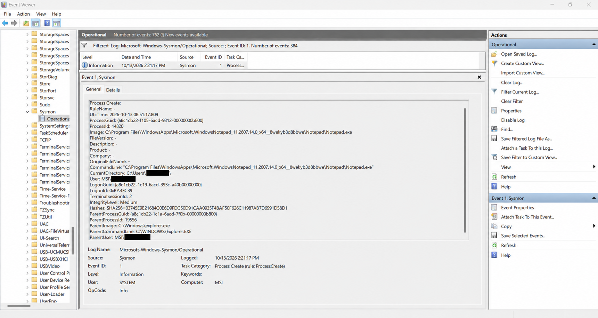

# Detection Lab 04 — Sysmon Process Analysis

## Status

🟠 In Progress — Local Sysmon process monitoring verified.
Wazuh SIEM integration is pending.

---

## Objective

The objective of this lab is to use Microsoft Sysmon to collect detailed
process creation telemetry from a Windows 11 endpoint and analyze that
activity through Windows Event Viewer and Wazuh.

This lab will help demonstrate how SOC analysts investigate process
execution, parent-child process relationships, command-line activity,
and executable metadata.

---

## Environment

| Component | Configuration |
|---|---|
| Endpoint | Windows 11 |
| SIEM | Wazuh |
| Endpoint Agent | Wazuh Agent |
| Monitoring Tool | Microsoft Sysmon |
| Log Source | Microsoft-Windows-Sysmon/Operational |
| Primary Event | Sysmon Event ID 1 — Process Create |

---

## Lab Scenario

Microsoft Sysmon will be installed and configured on the Windows endpoint.

Several harmless applications and commands will then be executed to
generate process creation events.

The resulting telemetry will be reviewed to understand how Windows
process activity appears in Sysmon and Wazuh.

---

## Planned Test Procedure

1. Install Microsoft Sysmon.
2. Apply a Sysmon configuration.
3. Verify that the Sysmon service is running.
4. Open Windows Event Viewer.
5. Execute several harmless applications or commands.
6. Locate Sysmon process creation events.
7. Review the same telemetry in Wazuh.
8. Compare parent and child process relationships.
9. Document relevant process details.

---

## Planned Test Activity

Harmless programs and commands will be used during this exercise.

Examples:

```text
notepad.exe
cmd.exe
powershell.exe
whoami
ipconfig
```

---

## Evidence

### Sysmon Event ID 1 — Notepad Process Creation

The following screenshot shows a process creation event captured using Microsoft Sysmon on Windows 11.



The screenshot demonstrates that Sysmon successfully recorded process execution, including the executable path, command line, process identifier, parent process, integrity level, and file hash.

Personal Windows username information has been redacted before publication.

---

## Observed Results

Microsoft Sysmon was successfully enabled and initialized on the Windows 11 endpoint.

The Sysmon service was verified as running using PowerShell.

A controlled test was performed by launching Microsoft Notepad.

The resulting process creation event was identified in Windows Event Viewer.

### Event Details

| Field | Observed Value |
|---|---|
| Event ID | 1 |
| Event Type | Process Create |
| Application | Notepad.exe |
| Process ID | 14820 |
| Parent Process | explorer.exe |
| Parent Process ID | 19556 |
| Integrity Level | Medium |
| Timestamp | 2026-10-13 14:21:17 (Sri Lanka) |
| Log Source | Microsoft-Windows-Sysmon/Operational |
| File Hash | SHA-256 recorded |

---

## Analysis

The Sysmon Event ID 1 record confirmed that Microsoft Notepad was launched on the Windows 11 endpoint.

The ParentImage field identified `C:\Windows\explorer.exe` as the parent process.

The observed process relationship was:

```text
explorer.exe
    |
    +--- Notepad.exe
```

The process executed with Medium integrity, consistent with a normal non-elevated user application.

Sysmon also recorded a SHA-256 file hash, which can support executable identification during security investigations.

### Security Assessment

The activity was generated intentionally as part of a controlled monitoring exercise.

No malicious behavior was identified from this event.

The exercise verified that Sysmon successfully collected detailed process creation telemetry.

Wazuh SIEM integration remains pending.

---

## MITRE ATT&CK Mapping

No malicious technique has been identified in this controlled Notepad execution test.

---

## Lessons Learned

- Learned how to install and verify Microsoft Sysmon using its default configuration.
- Identified Sysmon Event ID 1 in Windows Event Viewer.
- Examined process creation telemetry.
- Understood parent-child process relationships.
- Reviewed executable paths, command lines, integrity levels, and file hashes.
- Collected real evidence for a cybersecurity investigation.
