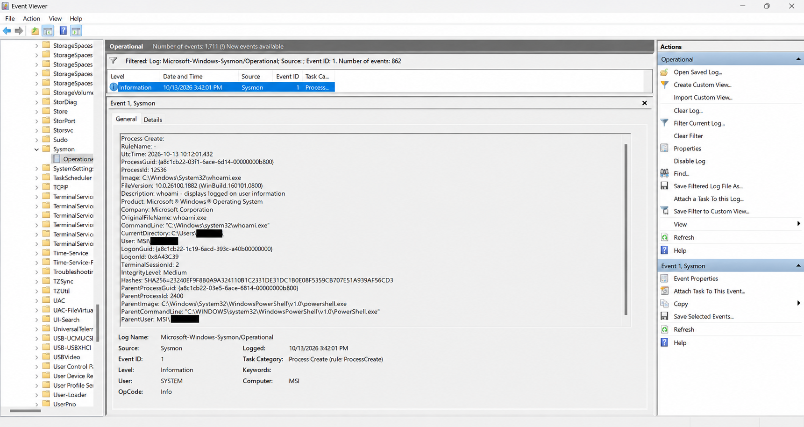

# Detection Lab 04 — Sysmon Process Analysis

## Status

🟠 **In Progress — Local Sysmon process monitoring completed and verified.**

The local Windows monitoring phase of this lab has been successfully implemented and documented.

Wazuh SIEM integration remains pending.

---

## Objective

The objective of this lab is to use Microsoft Sysmon to collect detailed process creation telemetry from a Windows 11 endpoint and investigate the resulting security events using Windows Event Viewer.

This lab demonstrates how SOC analysts examine:

- Process execution activity.
- Parent-child process relationships.
- Command-line arguments.
- Process identifiers.
- Executable paths and metadata.
- Process integrity levels.
- SHA-256 file hashes.

Future integration with Wazuh will extend the investigation capabilities through centralized security event collection and monitoring.

---

## Environment

| Component | Configuration | Status |
|---|---|---|
| Endpoint | Windows 11 | Implemented |
| Monitoring Tool | Microsoft Sysmon | Verified |
| Sysmon Installation | Built-in Windows Optional Feature | Enabled |
| Investigation Tool | Windows Event Viewer | Verified |
| Command-Line Tool | Windows PowerShell | Used |
| Log Source | Microsoft-Windows-Sysmon/Operational | Verified |
| Primary Event | Sysmon Event ID 1 — Process Create | Verified |
| SIEM | Wazuh | Pending |
| Endpoint Agent | Wazuh Agent | Pending |

The current monitoring environment operates locally on the Windows 11 endpoint.

No Wazuh SIEM integration was used during the documented investigations.

---

## Lab Scenario

Microsoft Sysmon was enabled and initialized on the Windows 11 endpoint to collect detailed process creation telemetry.

Two controlled monitoring exercises were conducted:

1. Launching Microsoft Notepad as a normal Windows application.
2. Executing the Windows `whoami.exe` utility through PowerShell.

These activities were intentionally generated to produce Sysmon Event ID 1 records.

The resulting events were investigated using Windows Event Viewer to identify process execution details and parent-child process relationships.

Both exercises were performed using legitimate Windows applications and commands.

---

## Implementation and Test Procedure

The following activities were completed during the local monitoring phase.

### Step 1 — Enable Microsoft Sysmon

The built-in Windows Sysmon optional feature was enabled using Administrator PowerShell.

```powershell
Enable-WindowsOptionalFeature -Online -FeatureName Sysmon
```

Sysmon was initialized using:

```powershell
sysmon -i
```

The default Sysmon configuration was used during the documented investigations.

No separate custom Sysmon XML configuration was applied.

### Step 2 — Verify Sysmon Installation

The Sysmon service was verified using PowerShell.

```powershell
Get-Service sysmon*
```

The service was confirmed to be running.

The built-in Windows optional feature was also verified using:

```powershell
Get-WindowsOptionalFeature -Online -FeatureName Sysmon
```

The observed result confirmed:

```text
FeatureName : Sysmon
DisplayName : Sysmon
State       : Enabled
```

This verified that the built-in Windows Sysmon feature was enabled on the endpoint.

### Step 3 — Open Windows Event Viewer

The Sysmon Operational event log was accessed through:

```text
Event Viewer
  Applications and Services Logs
    Microsoft
      Windows
        Sysmon
          Operational
```

The log was filtered using:

```text
Event ID: 1
```

Event ID 1 records process creation activity.

### Step 4 — Generate Controlled Test Activity

Two monitoring scenarios were performed.

**Test 01 — Microsoft Notepad**

Microsoft Notepad was launched to generate a process creation event.

Executable:

```text
notepad.exe
```

**Test 02 — PowerShell and whoami.exe**

Windows PowerShell was opened, and the following command was executed:

```powershell
whoami.exe
```

This generated a child process under the PowerShell process.

### Step 5 — Investigate Sysmon Events

The resulting Event ID 1 records were located in Windows Event Viewer.

The following event information was examined:

- Process image and executable path.
- Process ID.
- Parent process image.
- Parent process ID.
- Command line.
- Integrity level.
- Event timestamp.
- SHA-256 executable hash.

### Step 6 — Document Investigation Evidence

Screenshots were captured for both controlled exercises.

Relevant process execution information was documented and analyzed.

Personal Windows username information was redacted from the published evidence.

---

## Evidence

### Evidence 01 — Sysmon Event ID 1: Notepad Process Creation

The following screenshot shows the process creation event captured when Microsoft Notepad was launched on the Windows 11 endpoint.


Sysmon successfully recorded:

- Executable path.
- Command-line information.
- Process identifier.
- Parent process.
- Integrity level.
- SHA-256 file hash.

The evidence confirms that Sysmon was collecting process creation telemetry.

Personal Windows username information was redacted before publication.

---

### Evidence 02 — Sysmon Event ID 1: PowerShell and whoami.exe

The following screenshot shows the controlled execution of `whoami.exe` through Windows PowerShell.



The corresponding Sysmon Event ID 1 recorded:

- Child process: `whoami.exe`.
- Parent process: `powershell.exe`.
- Process identifiers.
- Command-line information.
- Integrity level.
- Executable path.
- SHA-256 file hash.

The event demonstrated how Sysmon records command-line utilities executed as child processes.

Personal Windows username information was redacted before publication.

---

## Observed Results

Both controlled tests successfully generated Sysmon process creation events.

The resulting telemetry was identified and examined using Windows Event Viewer.

### Investigation 01 — Microsoft Notepad Process Execution

Microsoft Notepad was launched as part of the controlled monitoring exercise.

The corresponding Sysmon Event ID 1 was identified and analyzed.

#### Event Details

| Field | Observed Value |
|---|---|
| Event ID | 1 |
| Event Type | Process Create |
| Application | Notepad.exe |
| Process ID | 14820 |
| Parent Process | explorer.exe |
| Parent Process ID | 19556 |
| Integrity Level | Medium |
| Timestamp | 2026-10-13 14:21:17 (Sri Lanka) |
| Log Source | Microsoft-Windows-Sysmon/Operational |
| File Hash | SHA-256 recorded |

The event confirmed that Microsoft Notepad was launched on the Windows 11 endpoint.

### Investigation 02 — PowerShell Process Execution

A controlled test was performed by launching Windows PowerShell and executing `whoami.exe`.

The command executed successfully, and the corresponding Sysmon Event ID 1 was identified.

#### Event Details

| Field | Observed Value |
|---|---|
| Event ID | 1 |
| Event Type | Process Create |
| Application | whoami.exe |
| Process ID | 12536 |
| Parent Process | powershell.exe |
| Parent Process ID | 2400 |
| Integrity Level | Medium |
| Timestamp | 2026-10-13 15:42:01 (Sri Lanka) |
| Log Source | Microsoft-Windows-Sysmon/Operational |
| File Hash | SHA-256 recorded |

The event confirmed that PowerShell launched `whoami.exe` as a child process.

---

## Analysis

### Investigation 01 — Notepad Process Analysis

The Sysmon Event ID 1 record confirmed that Microsoft Notepad was launched on the Windows 11 endpoint.

The `ParentImage` field identified `C:\Windows\explorer.exe` as the parent process.

The observed process relationship was:

```text
explorer.exe
    |
    +--- Notepad.exe
```

The Notepad process was assigned Process ID `14820`.

Its parent process, Windows Explorer, had Process ID `19556`.

The process executed with Medium integrity, consistent with a normal non-elevated Windows application.

Sysmon also recorded a SHA-256 file hash, which can support executable identification during security investigations.

The observed activity was expected and did not indicate malicious execution in the context of this controlled test.

### Investigation 02 — PowerShell Process Analysis

The second investigation demonstrated how Sysmon records command-line utilities launched through Windows PowerShell.

The `ParentImage` field identified PowerShell as the parent process of `whoami.exe`.

The observed process relationship was:

```text
powershell.exe
    |
    +--- whoami.exe
```

The `whoami.exe` process was created with Process ID `12536`.

Its parent PowerShell process had Process ID `2400`.

The process executed with Medium integrity.

Sysmon also recorded:

- Executable path.
- Command-line arguments.
- Process creation timestamp.
- Parent process information.
- SHA-256 executable hash.

The activity was intentionally generated using a legitimate Windows utility.

No malicious behavior was identified from the collected evidence.

The investigation demonstrated how Sysmon enables SOC analysts to trace process execution and examine parent-child process relationships.

---

## Security Assessment

Both monitoring exercises were conducted intentionally as part of authorized cybersecurity testing.

The resulting process creation events were successfully collected and examined using Microsoft Sysmon and Windows Event Viewer.

### Findings

1. Sysmon successfully recorded process creation events.
2. Event ID 1 provided detailed executable and process information.
3. Parent-child process relationships were identified for both test scenarios.
4. Command-line information and process identifiers were available for investigation.
5. SHA-256 executable hashes were recorded.
6. The observed activities were consistent with the controlled test scenarios.

### Activity Classification

**Classification:** Benign — Expected Test Activity.

**Confirmed Security Incident:** No.

**Local Monitoring Result:** Successful.

The available evidence did not indicate malicious activity during either exercise.

These results confirm successful monitoring of the tested activities, rather than comprehensive detection coverage for all possible threats.

---

## MITRE ATT&CK Mapping

Both Notepad and PowerShell `whoami.exe` executions were intentionally performed as part of controlled monitoring exercises.

In malicious contexts, PowerShell execution and system information discovery can be associated with MITRE ATT&CK techniques.

For example:

| Technique | Technique ID | Relevance |
|---|---|---|
| PowerShell | T1059.001 | PowerShell can be used to execute commands |
| System Owner/User Discovery | T1033 | Utilities such as `whoami.exe` can identify the current user |

These mappings describe potentially relevant behaviors and do not establish malicious activity.

The collected evidence was consistent with authorized testing.

**No malicious ATT&CK technique was attributed to the observed activity.**

The primary objective was to demonstrate process monitoring and parent-child process analysis.

---

## Current Limitations

Although the local monitoring exercises were successful, several limitations remain.

- Events were investigated locally through Windows Event Viewer.
- Centralized Wazuh event collection has not been implemented.
- No Wazuh SIEM alerts were generated.
- The investigations involved a limited number of controlled test scenarios.
- No custom Sysmon detection configuration was evaluated.
- Automated alert correlation was not performed.

These limitations will be addressed progressively as the HomeSOC environment develops.

---

## Planned Wazuh SIEM Integration

The next phase of this lab involves integrating Microsoft Sysmon telemetry with Wazuh.

The following activities remain pending:

1. Deploy the Wazuh monitoring environment.
2. Install and enroll the Wazuh Agent on the Windows 11 endpoint.
3. Configure the agent to collect Sysmon Operational events.
4. Verify the collection of Sysmon Event ID 1 through Wazuh.
5. Generate additional controlled process execution activity.
6. Investigate the resulting telemetry through the Wazuh Dashboard.
7. Evaluate detection rules and security alert generation.
8. Document the centralized monitoring results.

These activities have not yet been completed.

The current lab documentation represents verified local Windows monitoring only.

---

## Lessons Learned

Through this investigation, the following practical skills were developed:

- Enabled and verified the built-in Windows Sysmon feature.
- Confirmed Sysmon process creation logging.
- Located Event ID 1 records in Windows Event Viewer.
- Examined process creation telemetry.
- Identified parent-child process relationships.
- Reviewed executable paths and command lines.
- Interpreted process identifiers and integrity levels.
- Examined SHA-256 executable hashes.
- Analyzed legitimate Windows process execution activity.
- Collected and documented security investigation evidence.
- Distinguished controlled test activity from suspicious or confirmed malicious behavior.

---

## Conclusion

Detection Lab 04 successfully demonstrated local Windows process monitoring using Microsoft Sysmon.

Two controlled investigations were completed:

1. Microsoft Notepad process execution.
2. PowerShell launching the `whoami.exe` utility.

Both activities generated Sysmon Event ID 1 records containing detailed process creation telemetry.

The investigation confirmed that Sysmon provides useful information for examining executable activity and identifying parent-child process relationships.

**Final Result:** Local Sysmon process monitoring successfully implemented and verified.

**Wazuh SIEM Integration:** Pending.

The collected evidence establishes a foundation for future centralized monitoring and security investigation capabilities within the HomeSOC project.

---

## Disclaimer

All activities were performed as part of authorized cybersecurity training.

The documented executions were legitimate, controlled tests and do not represent confirmed malicious activity or an actual security incident.
