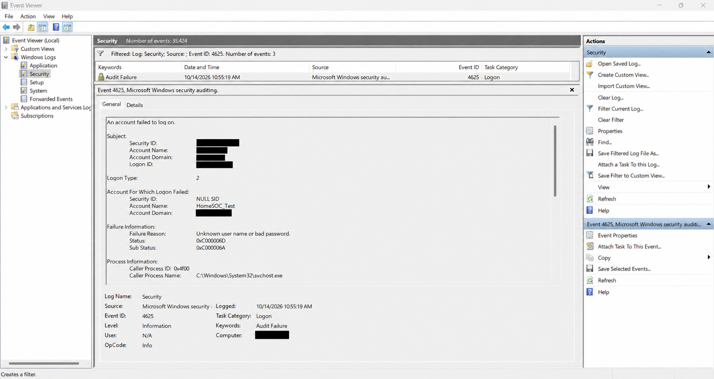

# HomeSOC — Security Investigation Report 001

## Investigation Information

| Field | Details |
|---|---|
| Investigation ID | INV-001 |
| Investigation Title | Windows Failed Authentication Investigation |
| Event Date | 2026-10-14 |
| Endpoint | Windows 11 |
| Detection Source | Windows Security Event Log |
| Investigation Tool | Windows Event Viewer |
| Event ID | 4625 |
| Severity | Informational — Controlled Test |
| Investigation Type | Authorized Lab Exercise |
| Activity Classification | Benign — Expected Test Activity |
| Investigation Status | Closed — Local Investigation Completed |
| Wazuh Integration | Pending |

---

## Incident Summary

A controlled authentication failure was generated on a Windows 11 endpoint as part of HomeSOC Detection Lab 02.

The activity involved an intentionally incorrect password supplied for a dedicated local test account named `HomeSOC_Test`.

Windows recorded the unsuccessful authentication attempt using Security Event ID 4625.

The event was identified and examined through Windows Event Viewer to understand the authentication failure reason, affected account, logon type, process information, and related security telemetry.

The activity was intentionally generated as part of an authorized lab exercise.

No malicious activity or genuine security compromise was established by the collected evidence.

---

## Detection

### Detection Method

The authentication failure was identified through Windows Security Event Logging.

The Windows Logon auditing policy had previously been verified as:

`Success and Failure`

This configuration enabled Windows to record unsuccessful authentication events.

The relevant log was accessed through:

`Event Viewer → Windows Logs → Security`

The log was filtered using Event ID `4625`.

The corresponding event was identified and examined.

### Detection Details

| Field | Observed Value |
|---|---|
| Event ID | 4625 |
| Event Description | An account failed to log on |
| Event Date | 2026-10-14 |
| Event Time | 10:55:19 AM (Sri Lanka) |
| Failed Account | `HomeSOC_Test` |
| Logon Type | 2 — Interactive |
| Failure Reason | Unknown user name or bad password |
| Status | `0xC000006D` |
| Substatus | `0xC000006A` |
| Caller Process | `svchost.exe` |
| Source Network Address | `::1` |
| Audit Result | Failure |

The authentication failure was recorded locally.

No Wazuh alert was generated or investigated because Wazuh integration was not deployed.

---

## Evidence

### Evidence EV-001 — Windows Security Event ID 4625

The following screenshot shows the Windows failed authentication event captured during the controlled investigation.

The screenshot demonstrates that Windows recorded the unsuccessful authentication attempt.

Relevant evidence includes:

- Windows Security Event ID 4625.
- Failed account name.
- Authentication failure reason.
- Status and substatus codes.
- Logon type.
- Caller process information.
- Event timestamp.

Personal Windows account and computer-identifying information was redacted from the published evidence where appropriate.

---

## Investigation

### 1. What Happened?

A failed authentication attempt was intentionally generated against the dedicated HomeSOC test account.

The test used incorrect credentials to verify whether Windows would record the unsuccessful authentication attempt.

Windows successfully generated Security Event ID 4625.

### 2. Which System Was Involved?

The activity occurred on the Windows 11 endpoint used for the HomeSOC project.

The event was recorded in the local Windows Security Event Log.

### 3. Which Account Was Involved?

The affected test account was:

`HomeSOC_Test`

This was a dedicated account created for controlled security testing.

### 4. Authentication Failure Analysis

The event recorded two important error codes.

**Status: `0xC000006D`**

This represents a general authentication failure involving an incorrect username or authentication information.

**Substatus: `0xC000006A`**

This indicates that an incorrect password was supplied for an account.

These values are consistent with the intentionally incorrect password used during the controlled test.

### 5. Logon Type Analysis

The event recorded:

`Logon Type: 2`

Logon Type 2 represents an interactive logon.

This was consistent with the authentication activity recorded during the exercise.

### 6. Process and Network Analysis

The event identified `svchost.exe` as the caller process.

The source network address was recorded as `::1`, the IPv6 loopback address.

This indicates a local source address rather than evidence of a remote external connection.

### 7. Security Interpretation

The observed authentication failure was expected because the test intentionally supplied incorrect credentials.

The evidence confirms an unsuccessful authentication attempt.

It does not establish unauthorized access, a brute-force attack, or successful account compromise.

---

## Timeline

| Time (Sri Lanka) | Activity |
|---|---|
| Before 10:55:19 AM | Dedicated `HomeSOC_Test` account prepared for controlled testing |
| 10:55:19 AM | Windows recorded the failed authentication attempt |
| After event generation | Event ID 4625 identified and investigated in Event Viewer |
| After investigation | Relevant evidence collected and documented |

Exact timestamps for account preparation and investigation activities were not separately recorded.

---

## MITRE ATT&CK Mapping

**Potentially Relevant Tactic:** Credential Access

**Potentially Relevant Technique:** Brute Force

**Technique ID:** T1110

**Assessment:** Not attributed to the observed activity.

Repeated authentication failures can be associated with brute-force activity in malicious scenarios.

However, this investigation involved a controlled authentication failure using an intentionally incorrect password.

The available evidence does not support classifying the activity as a brute-force attack.

No malicious MITRE ATT&CK technique was confirmed.

---

## Impact

### Observed Impact

The authentication attempt failed as expected.

No unauthorized successful login or system compromise was established during this investigation.

The event demonstrated that Windows Security Auditing could record the attempted authentication.

### Potential Security Relevance

In a production environment, repeated authentication failures may indicate:

- Incorrect user credentials.
- Account misconfiguration.
- Password guessing.
- Unauthorized authentication attempts.

Additional investigation would be required to distinguish legitimate user errors from potentially malicious activity.

---

## Remediation

### Actions Taken

- Generated a controlled authentication failure.
- Identified Windows Security Event ID 4625.
- Examined authentication failure information.
- Reviewed the recorded account, process, and network details.
- Collected supporting evidence.
- Documented the investigation findings.

### Recommended Security Improvements

- Monitor repeated failed authentication attempts.
- Review patterns involving multiple failed attempts against the same account.
- Correlate authentication events over time.
- Configure appropriate account lockout policies.
- Enable centralized security monitoring when Wazuh becomes available.
- Develop alerts for suspicious authentication patterns.

No incident containment or emergency remediation was required for this controlled exercise.

---

## Conclusion

HomeSOC Investigation INV-001 successfully demonstrated how Windows Security Event ID 4625 can be used to identify and investigate unsuccessful authentication attempts.

The event provided information about the affected account, logon type, authentication failure reason, process information, and source address.

The collected evidence was consistent with the intentionally incorrect password used during the lab.

**Final Assessment:** Expected authentication failure generated during authorized security testing.

**Confirmed Security Incident:** No.

**Investigation Status:** Closed — Local Investigation Completed.

Wazuh SIEM integration remains pending.

---

## References

- [HomeSOC Detection Lab 02](../Detection-Labs/02-failed-authentication-detection.md)
- [HomeSOC Monitoring Configurations](../Configs/README.md)
- [Microsoft Windows Security Event 4625](https://learn.microsoft.com/en-us/windows/security/threat-protection/auditing/event-4625)
- [MITRE ATT&CK — Brute Force (T1110)](https://attack.mitre.org/techniques/T1110/)

---

## Disclaimer

This investigation documents an authorized cybersecurity lab exercise.

The authentication failure was intentionally generated to verify Windows security monitoring capabilities.

The activity does not represent a confirmed real-world cyberattack.
